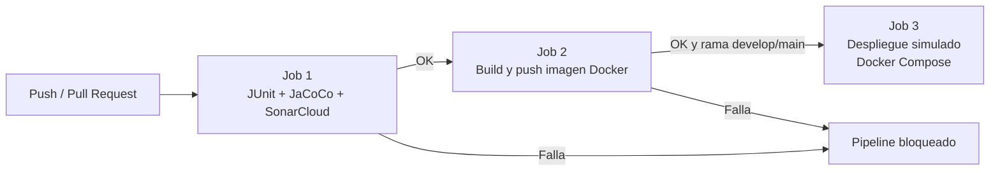
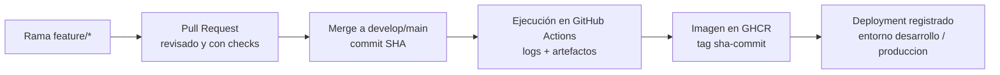

# eva2-devops — Pipeline CI/CD para `msvc-ingrediente`

[](https://github.com/ianreyescollao/eva2-devops/actions/workflows/ci.yml)
[](https://sonarcloud.io/summary/new_code?id=ianreyescollao_eva2-devops)

**Asignatura:** DOY0101 – Ingeniería DevOps · **Evaluación Parcial N°2:** *Añadiéndole complejidad a nuestro pipeline*

**Integrantes:**
- Ian Reyes Collao
- Joaquín Ferrada Castillo

---

## Índice
1. [Descripción del proyecto](#1-descripción-del-proyecto)
2. [Tecnologías utilizadas](#2-tecnologías-utilizadas)
3. [Cómo ejecutar el proyecto](#3-cómo-ejecutar-el-proyecto)
4. [Contenerización (Dockerfile)](#4-contenerización-dockerfile)
5. [Orquestación (Docker Compose)](#5-orquestación-docker-compose)
6. [Pipeline CI/CD](#6-pipeline-cicd)
7. [Calidad del software](#7-calidad-del-software)
8. [Seguridad](#8-seguridad)
9. [Trazabilidad](#9-trazabilidad)
10. [Estrategia de ramas y Pull Requests](#10-estrategia-de-ramas-y-pull-requests)
11. [Relación con los indicadores de evaluación](#11-relación-con-los-indicadores-de-evaluación)
12. [Verificación](#12-verificación)
13. [Limitaciones y mejoras futuras](#13-limitaciones-y-mejoras-futuras)
14. [Declaración de uso de Inteligencia Artificial](#14-declaración-de-uso-de-inteligencia-artificial)
15. [Conclusiones y reflexiones individuales](#15-conclusiones-y-reflexiones-individuales)

---

## 1. Descripción del proyecto

`msvc-ingrediente` es un microservicio REST del proyecto **CocinApp** que gestiona ingredientes y sus lotes de stock. Sobre este microservicio se construyó un pipeline CI/CD en **GitHub Actions** que automatiza todo su ciclo de vida: pruebas, análisis de calidad y seguridad, construcción de la imagen Docker, publicación en un registro de contenedores y despliegue automático en un entorno simulado con Docker Compose.

### Endpoints principales

| Método | Ruta | Descripción |
|---|---|---|
| GET | `/api/ingredientes` | Lista todos los ingredientes |
| GET | `/api/ingredientes/{id}` | Obtiene un ingrediente por id |
| POST | `/api/ingredientes` | Crea un ingrediente |
| PUT | `/api/ingredientes/{id}` | Actualiza un ingrediente |
| DELETE | `/api/ingredientes/{id}` | Elimina un ingrediente |
| POST | `/api/ingredientes/{idIngrediente}/lotes` | Registra un lote de un ingrediente |
| GET | `/api/ingredientes/{idIngrediente}/lotes` | Lista los lotes de un ingrediente |
| GET | `/api/ingredientes/{idIngrediente}/stock` | Consulta el stock de un ingrediente |

---

## 2. Tecnologías utilizadas

| Área | Herramienta |
|---|---|
| Lenguaje / framework | Java 21, Spring Boot 4 |
| Build | Maven (Maven Wrapper `mvnw`) |
| Base de datos | H2 (modo archivo) |
| Pruebas unitarias | JUnit 5 |
| Cobertura de código | JaCoCo 0.8.14 |
| Calidad y seguridad del código | SonarCloud (SonarQube Cloud) |
| Seguridad de dependencias | Dependabot |
| Contenedores | Docker (build multi-stage) |
| Orquestación | Docker Compose |
| CI/CD | GitHub Actions |
| Registro de imágenes | GitHub Container Registry (GHCR) |

---

## 3. Cómo ejecutar el proyecto

### Requisitos
- Java 21 (solo para ejecución local sin Docker)
- Docker Desktop (incluye Docker Compose v2)

### Opción A: con Maven (local)
```bash
./mvnw spring-boot:run          # Windows: mvnw.cmd spring-boot:run
```

### Opción B: con Docker Compose (recomendada)
```bash
docker compose up -d --build                   # construye la imagen y levanta el servicio
docker compose ps                              # verifica el estado
curl http://localhost:8080/api/ingredientes    # prueba la API (responde [] si está vacía)
docker compose down                            # detiene el entorno (down -v borra también los datos)
```

### Ejecutar pruebas y ver cobertura
```bash
./mvnw clean verify
# Reporte de cobertura: target/site/jacoco/index.html
```

---

## 4. Contenerización (Dockerfile)

El microservicio se contenedoriza con un **Dockerfile multi-stage**:

| Etapa | Imagen base | Función |
|---|---|---|
| `build` | `maven:3.9-eclipse-temurin-21` | Compila el proyecto y genera el `.jar` |
| final | `eclipse-temurin:21-jre` | Contiene solo el JRE y el `.jar` |

**Por qué multi-stage:** la imagen final no incluye Maven, el JDK ni el código fuente, solo lo necesario para ejecutar la aplicación. Así la imagen es más liviana, se descarga más rápido y expone menos superficie de ataque.

El archivo `.dockerignore` excluye `.git`, `target`, `data`, archivos del IDE y logs, para que el contexto de build sea pequeño y no se filtren archivos innecesarios dentro de la imagen.

---

## 5. Orquestación (Docker Compose)

El archivo `docker-compose.yml` define cómo se ejecuta el microservicio en el entorno simulado:

| Configuración | Valor | Propósito |
|---|---|---|
| `build` | `Dockerfile` del repositorio | Construye la imagen localmente |
| `image` | `msvc-ingrediente:latest` | Nombre de la imagen (el pipeline la reemplaza por la del commit) |
| `restart` | `unless-stopped` | Reinicia el contenedor automáticamente si falla |
| `ports` | `8080:8080` | Expone la API |
| `volumes` | `h2-data:/app/data` | Persiste la base de datos H2 aunque el contenedor se elimine |
| `networks` | `backend` (bridge) | Red aislada, preparada para sumar más servicios |
| `deploy.resources.limits` | 1 CPU / 768 MB | Evita que el contenedor consuma más recursos de los necesarios |
| `deploy.resources.reservations` | 0,5 CPU / 384 MB | Recursos mínimos garantizados |
| `JAVA_TOOL_OPTIONS` | `-XX:MaxRAMPercentage=75.0` | La JVM ajusta su memoria al límite del contenedor |

Los límites de recursos y la política de reinicio son los **parámetros de escalabilidad y estabilidad** del entorno: definen cuánto consume cada instancia y permiten planificar cuántas réplicas caben en un servidor.

---

## 6. Pipeline CI/CD

El pipeline está en `.github/workflows/ci.yml` y está formado por **tres jobs encadenados con `needs`**. Si un job falla, los siguientes no se ejecutan.



### Cuándo se ejecuta

| Evento | Ramas | Jobs que corren |
|---|---|---|
| `push` | `feature/**` | Pruebas + Build de imagen |
| `pull_request` | hacia `develop` o `main` | Pruebas + Build de imagen (sin publicar) |
| `push` (merge) | `develop` | Pruebas + Build y push + **Despliegue en entorno `desarrollo`** |
| `push` (merge) | `main` | Pruebas + **Quality Gate obligatorio** + Build y push + **Despliegue en entorno `produccion`** |

### Job 1: JUnit, JaCoCo y SonarCloud
1. Descarga el repositorio (con historial completo, necesario para SonarCloud).
2. Configura Java 21 (Temurin) con caché de dependencias Maven.
3. Ejecuta `./mvnw clean verify`: compila, corre las pruebas JUnit y genera el reporte JaCoCo. **Si una prueba falla, el pipeline se detiene.**
4. Publica el reporte de cobertura como artefacto (`reporte-jacoco`).
5. Envía el análisis a SonarCloud. En `main` espera el resultado del Quality Gate (`sonar.qualitygate.wait=true`) y **falla si no se cumple**.

### Job 2: Build y push de imagen Docker
1. Construye la imagen con Docker Buildx, usando la caché de GitHub Actions para acelerar builds sucesivos.
2. Genera las etiquetas de la imagen con `docker/metadata-action`:
   - `sha-<commit completo>`: identifica exactamente qué código contiene la imagen.
   - `<rama>`: por ejemplo, `develop`.
   - `latest`: solo en la rama principal.
3. En eventos `push` publica la imagen en **GitHub Container Registry** (`ghcr.io/ianreyescollao/eva2-devops`). En los PR solo la construye, para validar que el Dockerfile funciona.

### Job 3: Despliegue simulado con Docker Compose
Solo se ejecuta con **push a `develop` o `main`**, es decir, después de un merge aprobado.
1. Descarga desde GHCR **la imagen exacta del commit** (`sha-<commit>`).
2. Levanta el entorno con `docker compose up -d --no-build`, usando la imagen ya construida, sin recompilar.
3. Ejecuta una **prueba de humo**: consulta `GET /api/ingredientes` hasta 30 veces, cada 5 segundos. Si la API no responde, muestra los logs y el job falla.
4. Baja el entorno (`docker compose down -v`) aunque el job haya fallado.

El job usa **GitHub Environments** (`desarrollo` / `produccion`), así que cada despliegue queda registrado en la sección *Deployments* del repositorio.

---

## 7. Calidad del software

La calidad se garantiza con varias capas de control automático:

| Control | Herramienta | Qué asegura |
|---|---|---|
| Pruebas unitarias | JUnit 5 | Que la lógica de controladores, servicios, repositorios, mapper y modelo funcione correctamente |
| Cobertura | JaCoCo | Mide qué porcentaje del código ejecutan las pruebas. El reporte queda como artefacto en cada ejecución y se envía a SonarCloud |
| Análisis estático | SonarCloud | Detecta bugs, code smells, duplicación y problemas de seguridad en cada cambio |
| Quality Gate | SonarCloud | Define condiciones mínimas (calificación de seguridad, fiabilidad, cobertura y duplicación en código nuevo). Si no se cumplen, el cambio se bloquea |
| Protección de ramas | GitHub | `develop` y `main` exigen que los checks *JUnit, JaCoCo y SonarCloud* y *SonarCloud Code Analysis* estén en verde antes de permitir el merge |

### Bloqueo del pipeline si falla el análisis
El bloqueo funciona en dos niveles:

1. **En los Pull Requests**, el check *SonarCloud Code Analysis* es obligatorio (*Required*). Si el Quality Gate falla, GitHub **no permite hacer el merge**.
2. **En `main` (producción)**, el pipeline espera el resultado del Quality Gate. Si falla, el job 1 termina con error y **no se construye ni se despliega la imagen**.

> **Nota técnica:** el plan gratuito de SonarCloud no permite consultar el Quality Gate de ramas distintas a la principal desde el pipeline. Por eso la espera (`sonar.qualitygate.wait`) está activa solo en `main`, y en las demás ramas el bloqueo lo aplica la protección de ramas de GitHub.

---

## 8. Seguridad

| Medida | Implementación |
|---|---|
| **Análisis de dependencias** | Dependabot revisa semanalmente las dependencias de **Maven** y de **GitHub Actions** y abre PR automáticos hacia `develop` cuando hay versiones nuevas o vulnerabilidades |
| **Análisis de código (SAST)** | SonarCloud analiza el código Java y los workflows de GitHub Actions en cada PR |
| **Acciones fijadas por SHA** | Las acciones de terceros (`docker/*`) están fijadas al hash completo del commit, no a una etiqueta como `@v3`. Las etiquetas pueden moverse si un repositorio es comprometido; el hash no |
| **Permisos mínimos** | Cada job declara solo los permisos que necesita (`contents: read`; `packages: write` solo en el job que publica la imagen) |
| **Gestión de secretos** | `SONAR_TOKEN` se guarda como *GitHub Secret*. Para GHCR se usa el `GITHUB_TOKEN` temporal que GitHub genera en cada ejecución; no hay credenciales en el código |
| **Imagen mínima** | La imagen final solo contiene el JRE y el `.jar` (multi-stage) |

### Caso real: bloqueo por seguridad (PR #9)
Al incorporar las acciones de Docker al pipeline, SonarCloud detectó 5 problemas de seguridad (*"Use full commit SHA hash for this dependency"*). La calificación de seguridad del código nuevo bajó a **C** y el Quality Gate **bloqueó el merge**. Se corrigió fijando cada acción a su commit SHA y el Quality Gate volvió a aprobar. Esto demuestra que los controles de seguridad del pipeline funcionan como barrera real.

---

## 9. Trazabilidad

Cada cambio se puede seguir desde el código hasta su despliegue:



| Elemento | Dónde se ve | Qué permite rastrear |
|---|---|---|
| Commit (SHA) | Historial de Git | Qué cambió, quién y cuándo |
| Pull Request | Pestaña *Pull requests* | Por qué se hizo el cambio, revisión y resultado de los checks |
| Ejecución del pipeline | Pestaña *Actions* | Resultado de cada etapa, logs y duración |
| Artefactos | Ejecución en *Actions* | Reporte de cobertura JaCoCo de ese commit |
| Análisis de calidad | SonarCloud / comentario del bot en el PR | Estado del Quality Gate de ese cambio |
| Imagen Docker | *Packages* (GHCR) | Etiqueta `sha-<commit>`: qué código exacto contiene cada imagen |
| Despliegue | Sección *Deployments* / *Environments* | Qué commit está desplegado en cada entorno |

Como el despliegue descarga la imagen etiquetada con el SHA del commit que lo disparó, **lo que se prueba es exactamente lo que se despliega**.

---

## 10. Estrategia de ramas y Pull Requests

```
feature/*  ──PR──▶  develop  ──PR (release)──▶  main
```

- **`main`**: versión estable (producción).
- **`develop`**: integración de funcionalidades (entorno de desarrollo).
- **`feature/<tarea>`**: una rama por tarea. Se integra a `develop` solo mediante Pull Request con todos los checks en verde.

| PR | Rama | Contenido |
|---|---|---|
| #1 | `feature/JUnit` | Pruebas unitarias con JUnit y ejecución en GitHub Actions |
| #2 | `feature/jacoco` | Cobertura con JaCoCo |
| #3 | `feature/sonarCloud` | Integración con SonarCloud |
| #6 | `feature/dependabot` | Configuración de Dependabot |
| #7 | `feature/docker` | Dockerfile y `.dockerignore` |
| #8 | `feature/docker-compose` | Orquestación con Docker Compose |
| #9 | `feature/cicd` | Build de imagen, bloqueo por calidad y despliegue automático |
| — | `feature/docs` | Documentación (este README) |

Además, se usó la rama `feature/test-bloqueo` con una prueba que falla a propósito, para verificar que el pipeline bloquea la integración cuando una prueba no pasa.

---

## 11. Relación con los indicadores de evaluación

| Indicador | Cómo se cumple |
|---|---|
| **IE1** – Uso de contenedores | Dockerfile multi-stage con imagen final basada en JRE; la imagen se construye en el pipeline y se publica en GHCR |
| **IE2** – Pruebas automatizadas | JUnit + JaCoCo en cada push y PR; el pipeline se detiene si una prueba falla; reporte de cobertura como artefacto |
| **IE3** – Escalabilidad y seguridad | Límites y reservas de CPU/memoria, política de reinicio, Dependabot, SonarCloud con Quality Gate, bloqueo de merge, acciones fijadas por SHA, permisos mínimos y secretos |
| **IE4** – Despliegue automático y trazable | Despliegue automático con Docker Compose al integrar en `develop`/`main`, prueba de humo, imágenes etiquetadas por commit y despliegues registrados por entorno |
| **IE5** – Orquestación | Docker Compose con red dedicada, volumen persistente, límites de recursos y reinicio automático |

---

## 12. Verificación

Para comprobar el funcionamiento del proyecto:

**Ejecución local**
1. Clonar el repositorio y, en la raíz, ejecutar `docker compose up -d --build`.
2. Verificar con `docker compose ps` que el contenedor esté en ejecución.
3. Abrir `http://localhost:8080/api/ingredientes` (responde `[]` si no hay datos).
4. Ejecutar `./mvnw clean verify` y abrir `target/site/jacoco/index.html` para ver la cobertura.

**En GitHub**
| Qué revisar | Dónde |
|---|---|
| Ejecuciones del pipeline y sus 3 jobs | Pestaña **Actions** → workflow *CI - Calidad de Codigo* |
| Prueba de humo del despliegue | Job *Despliegue simulado con Docker Compose* → paso *Prueba de humo* |
| Reporte de cobertura JaCoCo | Artefacto `reporte-jacoco` en cada ejecución |
| Imagen publicada con etiqueta por commit | Sección **Packages** del repositorio |
| Despliegues por entorno | Sección **Deployments** (`desarrollo` / `produccion`) |
| Bloqueo por seguridad y su corrección | PR **#9** → pestaña *Checks* y comentario de SonarCloud |
| Historial de integración por tarea | Pestaña **Pull requests** (cerrados) |

## 13. Limitaciones y mejoras futuras

- **Base de datos:** se usa H2 embebida, por lo que Docker Compose orquesta un único contenedor. Como mejora, se puede agregar un servicio de base de datos independiente (por ejemplo, MySQL) con `healthcheck` y `depends_on: condition: service_healthy`.
- **Plan gratuito de SonarCloud:** no permite esperar el Quality Gate desde el pipeline en ramas que no son `main`; el bloqueo en esas ramas lo cubre la protección de ramas.
- **Entorno simulado:** el despliegue se hace en el runner de GitHub Actions, que es temporal. Un siguiente paso sería desplegar en una nube real o en Kubernetes.
- **Imagen Docker:** se puede optimizar aún más con caché de dependencias por capas y ejecución con un usuario no-root.

---

## 14. Declaración de uso de Inteligencia Artificial

De acuerdo con las indicaciones de la evaluación, se declara el uso de las siguientes herramientas (citadas según https://bibliotecas.duoc.cl/ia):

| Herramienta | Uso | Validación por el equipo |
|---|---|---|
| Claude (Anthropic) | Apoyo en la configuración de Docker Compose y del pipeline de GitHub Actions, interpretación de los errores de SonarCloud (limitación del plan gratuito y fijación de acciones por SHA) y estructura de la documentación técnica de este README. | Cada cambio se aplicó manualmente, se probó localmente con Docker y se validó en GitHub Actions mediante Pull Requests antes de integrarlo. Las decisiones de diseño y la revisión final fueron del equipo. |

---

## 15. Conclusiones y reflexiones individuales

### Distribución del trabajo

| Integrante | Tareas | Pull Requests |
|---|---|---|
| Ian Reyes Collao | Pruebas unitarias con JUnit, cobertura con JaCoCo, integración con SonarCloud, configuración de Dependabot, Dockerfile y prueba de bloqueo del pipeline | #1, #2, #3, #6, #7 y `feature/test-bloqueo` |
| Joaquín Ferrada Castillo | Orquestación con Docker Compose, ampliación del pipeline (build de imagen, bloqueo por Quality Gate y despliegue automático), corrección de seguridad en SonarCloud y documentación | #8, #9 y `feature/docs` |

### Conclusión del equipo
Al principio el proyecto tenía pruebas y análisis de calidad, pero nada impedía que un cambio con errores llegara a las ramas principales, y no había forma automática de desplegar. Ahora cada cambio pasa por pruebas, análisis de calidad y seguridad, construcción de la imagen y despliegue, y si algo falla, no avanza.

Lo mejor fue ver que los controles funcionan de verdad: la prueba de bloqueo detuvo la integración y, en el PR #9, SonarCloud frenó un cambio nuestro por un problema de seguridad que no habíamos notado. Trabajar con ramas y Pull Requests también nos ayudó a ordenarnos. Quedó pendiente separar la base de datos en su propio contenedor y optimizar la imagen Docker.

